<h1 align="center">⚽ fullpitch</h1>

<p align="center"><b>Your GitHub player card — scored from <i>all</i> your work, private included.</b></p>

<p align="center">
  
</p>

<p align="center">
  <a href="#quick-start">Quick start</a> ·
  <a href="#inputs">Inputs</a> ·
  <a href="#how-the-score-is-built">How it's scored</a> ·
  <a href="#privacy">Privacy</a> ·
  <a href="#credits">Credits</a>
</p>

---

Football-style developer cards like [Gitwork](https://gitwork.dev) and [GitFut](https://gitfut.com) are great — but a hosted service can only see what *anyone* can see. If most of your work lives in private repos or company orgs, your card says you barely play.

**fullpitch** runs the same open scoring ([gitrank](https://github.com/gitwork-oss/gitrank), the formula Gitwork uses) inside *your own* GitHub Action, with *your own* token. It sees your private repos, private PRs and reviews, and every contribution GitHub counts on your profile — then renders an SVG straight into your README. No server, no third party holding your token.

| Same formula, same person | Overall | PAC | PHY | Contributions (12 mo) |
|---|:-:|:-:|:-:|:-:|
| Public data only (gitwork.dev, Oct 2026) | 65 | 69 | 45 | public only |
| **fullpitch** (public + private) | **84** | **76** | **88** | **2.2k** |

<p align="center">
  
  
  
</p>

## Quick start

**1. Create a token.** [Classic personal access token](https://github.com/settings/tokens/new?scopes=repo,read:user,read:org&description=fullpitch) with `repo`, `read:user` and `read:org` (the link pre-selects them). Add it to your profile repository (`<you>/<you>`) as a secret named `FULLPITCH_TOKEN`.

> Already using [lowlighter/metrics](https://github.com/lowlighter/metrics) with a `repo`-scoped token? That one works too.

**2. Add a workflow** — `.github/workflows/fullpitch.yml` in your profile repo:

```yaml
name: fullpitch card
on:
  schedule:
    - cron: "30 3 * * *" # daily
  workflow_dispatch:

permissions:
  contents: write

jobs:
  card:
    runs-on: ubuntu-latest
    steps:
      - uses: actions/checkout@v5
      - uses: DavidSanSan110/fullpitch@v1
        with:
          token: ${{ secrets.FULLPITCH_TOKEN }}
```

**3. Embed it** in your `README.md`:

```html
<p align="center"></p>
```

Run the workflow once from the **Actions** tab; after that it refreshes every night. The job summary shows exactly which numbers went in.

## Inputs

| Input | Default | What it does |
|---|---|---|
| `token` | — | **Required.** The profile owner's token. With `GITHUB_TOKEN` (or anyone else's token) only public data is visible. |
| `username` | repo owner | Who to card. |
| `output` | `fullpitch-card.svg` | Where the SVG goes. |
| `layout` | `banner` | `banner` (1200×630, card + details) or `card` (400×600). |
| `theme` | `auto` | `auto` follows your tier (in-form → navy, gold → gold…), or force `navy`, `gold`, `silver`, `bronze`, `black`. |
| `include_private` | `true` | Count private repos, PRs, reviews and contributions. |
| `public_calendar_floor` | `true` | Never report fewer contributions than your public profile calendar shows. |
| `language_ranking` | `repos` | Headline language by repo count (`repos`, like Gitwork/GitFut) or by last year's commits (`commits`). |
| `top_language` | — | Force the language shown (logo + sentence). Doesn't change the score. |
| `country` | from location | ISO code for the flag, e.g. `es`. Guessed from your profile location when unset. |
| `animate` | `true` | A subtle shine sweep across the card. |
| `json_output` | — | Also write a JSON with the card, the signals and the data sources — audit your score. |
| `commit` | `true` | Commit and push the result. Turn off to handle it yourself. |
| `commit_message` | `Update fullpitch card [skip ci]` | |

**Outputs:** `overall`, `position`, `finish`, `path`.

## How the score is built

Scoring is [gitrank](https://github.com/gitwork-oss/gitrank), unmodified and pinned to a commit: six stats (PAC activity, SHO impact, PAS collaboration, DRI range, DEF stewardship, PHY longevity) → position, overall, tier and archetype. fullpitch only changes what gitrank gets to *see*:

| Signal | Public-only scorers | fullpitch |
|---|---|---|
| Contributions (last year, lifetime) | public + GitHub's private lump, *if* the token can see it | max of your token's view and your public profile calendar, per year |
| Pull requests, reviews, issues | public only | + private ones, via search with your token |
| Repos, stars | public owned repos | all owned repos, private included |
| Language range & headline language | public repos | public + private repos, and repos you commit to |

Three sources, merged so no single blind spot shrinks the card:

1. **GraphQL as you** — private repos, their languages, contribution totals.
2. **Search as you** — private PRs/reviews/issues, which the contributions API otherwise reports only as an anonymous "restricted" count.
3. **Your public calendar** — the number on your profile page. Surprisingly, a token can see *less* than the public: contributions in orgs that restrict OAuth apps or need SSO vanish from the token's view but still count on your profile. The calendar is used as a floor so they're never lost.

GitHub doesn't expose a private *commit* count to anyone — not even the owner — so private contributions that aren't PRs, reviews or issues are counted as commits, as GitFut does.

## Privacy

- Your token stays in your repository's secrets and runs only in your Actions runner.
- The card shows **aggregates only**: totals, ratings, one language name. No repo names, no code, no org names.
- `json_output` (off by default) also contains only counts and language names.
- Want public-only? Set `include_private: false`.

## Run it locally

```bash
git clone https://github.com/DavidSanSan110/fullpitch && cd fullpitch && npm ci
GH_TOKEN=$(gh auth token) npx tsx src/main.ts --username <you> --output card.svg
npx tsx scripts/preview.ts card.svg   # → card.png
```

## For Gitwork / GitFut maintainers

The adapter in [`src/github/`](src/github) and [`src/signals.ts`](src/signals.ts) produces plain gitrank `Signals`, so a hosted service could offer the same thing behind "Sign in with GitHub" (with the `repo` scope, opt-in). Happy to help upstream it.

## Credits

- **Scoring:** [gitrank](https://github.com/gitwork-oss/gitrank) by gitwork-oss (MIT), itself extracted from [GitFut](https://github.com/younesfdj/gitfut) by Younes Ferradji and contributors (MIT). The six-stat card, OVR, tiers and archetypes are their work.
- **Language ranking:** vendored from GitFut ([`src/languages.ts`](src/languages.ts), MIT).
- **Font:** [Barlow Condensed](https://github.com/jpt/barlow) (SIL Open Font License, see [`fonts/OFL.txt`](fonts/OFL.txt)).
- **Logos:** [Devicon](https://devicon.dev) · **Flags:** [flagcdn](https://flagcdn.com).
- Card art is original SVG.

fullpitch is an independent project, not affiliated with Gitwork, GitFut, GitHub or EA Sports.

## License

[MIT](LICENSE)
